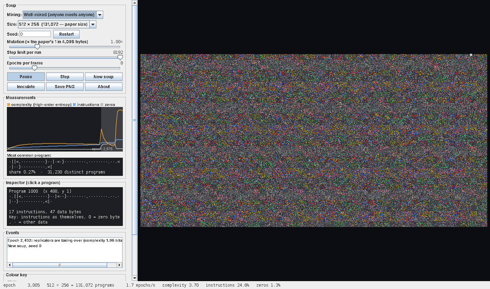

# Primordial Soup Lab

**Fill a soup with random computer code, stir, and watch self-replicating programs appear out of nowhere.**



How did life begin? Somewhere, somehow, a jumble of chemicals produced the first thing that could make copies of itself. Once that happened, copying took over, and evolution could start.

In 2024 a team at Google (Blaise Agüera y Arcas and colleagues) showed that something similar happens with computer code. They filled a "primordial soup" with 131,072 tiny programs made of random bytes, let them bump into each other at random, and waited. There was no goal, no reward and no selection. Yet after a few thousand rounds, programs appeared that copy themselves, and within a short time they took over the whole soup.

Primordial Soup Lab recreates that experiment so you can watch it happen on your own computer. It uses the same rules as the paper's own software and the same random numbers, so the first run you see reproduces the paper's reference run exactly.

You don't need to know any programming. Start it and watch the graph.

---

## Getting started

Primordial Soup Lab is a single file. It needs **Java 17 or newer** and nothing else.

1. **Check whether you already have Java.** Open Terminal (on a Mac) or Command Prompt (on Windows) and type:

   ```
   java -version
   ```

   If it reports version 17 or higher, skip to step 3.

2. **Install Java if needed.** A free, trustworthy build is available from [Adoptium](https://adoptium.net). Download the installer for your computer and run it.

3. **Download** `PrimordialSoupLab.java` from this repository.

4. **Run it.** In Terminal, go to the folder where you saved the file and type:

   ```
   java PrimordialSoupLab.java
   ```

The soup starts straight away with the paper's settings. **Replicators appear at around epoch 2,400**, which takes a few minutes depending on how fast your computer is.

---

## What you're looking at

### The soup

Every tile in the big picture is one program, 64 bytes long, drawn as an 8 × 8 square with one coloured pixel per byte. At the paper's size of 131,072 programs, each tile is tiny, so the soup looks like coloured static. Use **Size** to choose a smaller soup if you'd like to see individual programs, or click a tile and read it in the **Inspector**.

Only 10 of the 256 possible byte values are instructions. Everything else is inert data:

| Colour | Bytes | Meaning |
|---|---|---|
| Blues | `<` `>` | Move the read head left or right |
| Greens | `{` `}` | Move the write head left or right |
| Oranges | `+` `-` | Add or subtract 1 from the byte under the read head |
| Reds and pinks | `.` `,` | Copy a byte between the two heads |
| Yellows | `[` `]` | Loop while the byte under the read head isn't zero |
| Black | 0 | A zero byte |
| Grey | anything else | Inert data |


*Close-up of the same corner of the soup at epoch 1 (left) and epoch 2,944 (right). Before: mostly grey data with a few scattered instructions. After: every tile is crowded with copying instructions, and the same patterns repeat from tile to tile.*

### What happens each epoch

Each **epoch**, every program is paired with a random partner. The two are joined end to end into a 128-byte tape and run as one program for up to 8,192 steps. Then the tape is cut back into two halves and both go back into the soup. A tiny amount of random mutation, 1 byte in 4,096, is sprinkled in along the way.

The crucial detail is that **code and data share the same tape**. A program can read and overwrite itself, and its partner. Most of the time, the result is just a meaningless shuffle of bytes.

But occasionally, by pure chance, a program does something special: it copies itself over its partner. Now there are two copies. Each of those meets new partners and makes more copies, then four, eight, sixteen. Within a few hundred epochs the copies fill the soup.

### The measurements

The chart on the left tracks three things over time:

- **Complexity (orange).** This is the "high-order entropy" used in the paper: how varied the bytes in the soup are, minus how well the soup compresses. A random soup is varied but has no structure, so it scores close to zero. A soup full of replicators is varied and full of repeated structure, so it scores high. When replicators take over, this line jumps.
- **Instructions (blue).** The share of bytes that are instructions rather than inert data. It creeps up before the takeover and then leaps.
- **Zeros (grey).** The share of zero bytes. Zeros matter because a zero can stop a copying loop dead.

Underneath, **Most common program** shows the program that currently has the most identical copies. Before the takeover, it's usually a meaningless run of repeated bytes. Afterwards, it's an evolved self-replicator that nobody designed.

---

## The default run: life begins twice

The lab starts with the paper's own settings: 131,072 programs, well-mixed, **seed 0**. Because it uses the same random-number scheme as the paper's software, this run unfolds identically every time, on every computer.

It's worth watching closely, because life starts twice:

| Epoch | Complexity | What's happening |
|---|---|---|
| 1 | 0.00 | Random bytes. Only 4% of them are instructions. |
| 2,432 | 1.96 | **The first replicators appear** and spread rapidly. |
| 2,560 – 2,688 | 0.72 → 0.41 | The first wave collapses. Its replicators weren't robust enough to survive. |
| 2,816 | 2.36 | **A second, more successful lineage takes over.** |
| 2,944 | 3.75 | The soup is dominated by replicators and their mutated descendants. |

The most common program at epoch 2,816 looks like this, where `·` is inert data:

```
[<,··········}··]·<············,·········}·<·]··}··········,<[[·
```

Nobody wrote it. It was assembled from random bytes by nothing but chance and copying.

**Note:** once replicators take over, the simulation slows down sharply. Replicators spend their runs in long copying loops, so each epoch involves far more work. That's a sign the soup has come alive.

---

## Things to try

- **Change the seed.** Type a different number in **Seed** and press **Restart**, or press **New soup** for a random one. Other seeds are a lottery: in the paper, roughly 40% of runs produced replicators within 16,000 epochs. Leave the lab running and see whether your soup comes alive.
- **Spatial mode.** Switch **Mixing** to *Spatial*. Now programs only meet their near neighbours, as if the soup were a pond rather than a stirred pot. Replicators spread as visible waves, and different lineages compete for territory. It works best with a smaller soup.
- **Inoculate.** Press **Inoculate**, then click the soup to plant a small 5 × 5 colony of a known replicator by hand. In Spatial mode on a 128 × 72 soup, the colony reliably spreads. Watch the complexity graph: it keeps rising even after the original replicator fades, because its mutated descendants replace it.
- **Mutation.** Turn mutation off and replicators can still appear, as the paper found, because programs rewrite each other. Turn it up and copying errors accumulate faster.
- **The Inspector.** Click any tile to read its 64 bytes. Compare a program from before the takeover with one from after.

---

## The controls

| Control | What it does |
|---|---|
| **Mixing** | *Well-mixed*: any program can meet any other. *Spatial*: programs meet only neighbours within two tiles. |
| **Size** | From 2,304 programs up to 131,072, the paper's size. Replicators are much more likely to appear in a bigger soup. |
| **Seed / Restart** | Start the soup from a particular seed. Seed 0 at paper size reproduces the paper's reference run. |
| **Mutation** | A multiple of the paper's rate of 1 byte in 4,096 per run. |
| **Step limit per run** | How many steps each pair may run for. The paper uses 8,192. |
| **Epochs per frame** | How many epochs are calculated between screen updates. |
| **Play / Pause, Step** | Stop the action, or advance one epoch at a time. |
| **New soup** | Start again with a random seed. |
| **Inoculate** | Click the soup to plant a colony of a known replicator. |
| **Save PNG** | Save the current soup as an image. |

---

## How faithful is it?

The lab follows the paper's reference implementation, [cubff](https://github.com/paradigms-of-intelligence/cubff), and specifically its `bff_noheads` language, in which both heads and the instruction pointer start at position 0. The soup is filled, shuffled and mutated with the same SplitMix64 random-number scheme as cubff. When run headless with seed 0, it reproduces the reference run's takeover at the same point. The well-mixed mode matches cubff's default.

There are two differences worth knowing about. The complexity measure uses Java's built-in Deflate compression rather than Brotli, so the numbers differ slightly from the paper's, though they tell the same story. And the spatial mode is the lab's own version of neighbour-only mixing, so it doesn't reproduce cubff's 2D runs number for number.

The calculation runs on all your computer's processor cores and is written in plain Java, with no extra libraries.

---

## Credits

**Architect:** Mario Gianota
**Implementation:** Claude (Anthropic)

Released under the MIT licence.

Based on the paper *[Computational Life: How Well-formed, Self-replicating Programs Emerge from Simple Interaction](https://arxiv.org/abs/2406.19108)* by Blaise Agüera y Arcas, Jyrki Alakuijala, James Evans, Ben Laurie, Alexander Mordvintsev, Eyvind Niklasson, Ettore Randazzo and Luca Versari (2024), and its reference implementation [cubff](https://github.com/paradigms-of-intelligence/cubff).

If you enjoy this, try the companion labs **Gray–Scott Lab** (spots that divide like cells) and **Swift–Hohenberg Lab** (fingerprints and sand ripples).
